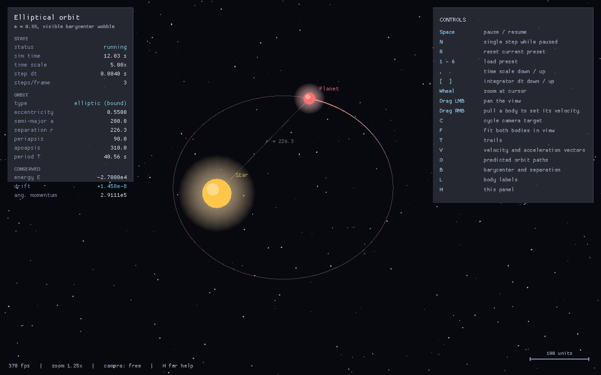

# Two-Body Gravity

A real-time simulation of two bodies under mutual Newtonian gravity, in Rust.
Physics runs in `f64` on a fixed timestep; rendering is immediate-mode OpenGL via
[macroquad](https://macroquad.rs).



## Running

```
cargo run --release
```

`--release` matters: the debug build is roughly an order of magnitude slower.

On Linux, macroquad also needs the system OpenGL and X11 development libraries —
on Debian or Ubuntu, `sudo apt install libx11-dev libxi-dev libgl1-mesa-dev`.

> A typeset PDF of everything below, with the formulas in proper math notation,
> can be built from `docs/two-body.tex`. See [Building the PDF](#building-the-pdf).

Optional flags:

| Flag | Effect |
| --- | --- |
| `--preset <1-6>` | start on a given configuration |
| `--capture <path>` | render a few seconds, write a PNG, exit (useful headless / in CI) |

## Controls

| Key | Action |
| --- | --- |
| `Space` | pause / resume |
| `N` | single step while paused |
| `R` | reset the current preset |
| `1`–`6` | load a preset |
| `,` `.` | time scale down / up |
| `[` `]` | integrator step size down / up |
| Wheel | zoom at the cursor |
| Drag LMB | pan |
| Drag RMB | pull from a body to set its velocity |
| `C` | cycle camera target (free / barycenter / either body) |
| `F` | frame the whole orbit |
| `T` `V` `O` `B` `L` | toggle trails, vectors, predicted orbits, barycenter, labels |
| `P` | save a screenshot to the working directory |
| `H` | controls panel |
| `Esc` / `Q` | quit |

## Presets

1. **Circular orbit** — `e = 0`, light satellite.
2. **Elliptical orbit** — `e = 0.55`, with a visible barycenter wobble.
3. **Comet** — `e = 0.9`, a fast periapsis passage.
4. **Equal-mass binary** — two identical bodies on mirrored ellipses.
5. **Hyperbolic flyby** — unbound; deflected once and gone.
6. **Radial infall** — zero angular momentum, straight-line collapse.

---

# How the simulation works

## 1. The physical model

Two point masses `m₀` and `m₁` at positions `r₀` and `r₁`. Everything below is
built from the separation vector between them:

```
d = r₁ − r₀
```

### Deriving the acceleration

**Step 1 — Newton's law of gravitation**, in the form everyone learns it. Note
that it gives only a *magnitude*:

```
|F| = G·m₀·m₁ / r²              r = |d|
```

**Step 2 — attach a direction.** Force is a vector, so the magnitude needs a unit
vector to point it. Body 0 is pulled *toward* body 1, and since `d` points from 0
to 1, that direction is `d̂ = d/|d|`:

```
F₀ = G·m₀·m₁/|d|² · d̂  =  G·m₀·m₁/|d|² · d/|d|  =  G·m₀·m₁·d / |d|³
```

**Step 3 — Newton's second law**, `F = m·a`, so divide through by `m₀`:

```
a₀ =  G·m₁ · d / |d|³
a₁ = −G·m₀ · d / |d|³
```

Those two lines are the entire physics. The rest of the simulation is machinery
for integrating them accurately and drawing the result.

### The cube is not an inverse-cube force

Gravity here is still `1/r²`. The exponent reads 3 only because `d` in the
numerator is *un-normalized* — it carries a factor of `|d|` in its own length.
Splitting it back apart:

```
   d       1        d          1
------  = ---- · -------  =  ---- · d̂
 |d|³     |d|²     |d|         r²
         ↑magnitude ↑direction
```

Fusing the two is a numerical convenience: normalizing `d` first and then scaling
would need a second division by `|d|`. The code computes `|d|³` as
`r2 * r2.sqrt()`, that is `|d|²·|d|`, for one square root in total.

Dimensions confirm it is an acceleration. With `[G] = m³·kg⁻¹·s⁻²`:

```
(m³·kg⁻¹·s⁻²)·(kg)·(m) / (m³)  =  m·s⁻²
```

Leaving `|d|²` in the denominator would yield `m²·s⁻²`, which is not an
acceleration — the cube is what makes the units come out right.

### Why m₀ cancels

The *force* on body 0 depends on both masses, but its *acceleration* depends only
on `m₁`, the mass of the other body. The `m₀` in the gravitational law is
cancelled by the `m₀` in `F = m₀a`.

That cancellation is the equivalence principle — how strongly a body is pulled and
how strongly it resists being pulled are the same number, so heavy and light
objects fall identically. It is visible directly in
`System::compute_accelerations` (`src/physics.rs`), where each body's
acceleration is scaled by the *other* body's mass:

```rust
self.bodies[0].acc = d * (self.g * m1 * inv_r3);   // uses the OTHER mass
self.bodies[1].acc = d * (-self.g * m0 * inv_r3);
```

The only difference between the two lines is the sign. Both bodies accelerate
along the same axis `d` in opposite directions, which is Newton's third law, and
why the pair's total momentum never changes.

### Why the state is stored as vectors

A two-body orbit is planar, so it could be described with scalars — a radius and
an angle, or a set of orbital elements — and some simulations do exactly that.
This one keeps position, velocity and acceleration as `V2` vectors and integrates
the ODE directly. The reasons are concrete:

- **A magnitude alone is not a force.** `G·m₀·m₁/r²` says how hard, never which
  way. The direction has to be reintroduced somehow; `d/|d|³` carries both at once
  and keeps the expression in a single term.
- **No trigonometry in the inner loop.** A polar formulation needs `atan2`, `sin`
  and `cos` every step. The vector form needs one `sqrt` and a handful of
  multiplies, and it never has to unwrap an angle across the `2π` boundary.
- **No special cases at the degenerate configurations.** In polar coordinates a
  radial free-fall has `ṙ` finite but `θ̇` undefined, and angular formulations
  need a branch to survive it. Preset 6 does exactly this, and the vector code
  runs it with no special handling: `d` simply shrinks along a fixed direction.
  (The separate problem of `|d| → 0` blowing up the force is what softening in §2
  addresses; that one is real, and no choice of coordinates avoids it.)
- **The orbit's orientation is an output, not a coordinate choice.** Nothing in
  the integrator knows where periapsis is or which way the orbit is tilted. The
  argument of periapsis `ω` is *derived* in §7 from the state, which is what makes
  those elements an independent check on the integrator rather than an assumption
  fed into it.
- **Forces superpose as vectors.** Adding a third body means summing `d/|d|³`
  terms over pairs; the loop body does not change. Scalar magnitudes cannot be
  summed without reintroducing direction anyway.
- **The integrator is agnostic.** Velocity Verlet (§3) is written once in terms of
  `+` and `·scalar` and applies unchanged to position, velocity and acceleration
  because all three are the same type. That is why `src/vec2.rs` implements the
  operator traits — the physics reads like the equations above.

The cost is that `V2` is a hand-rolled `f64` type rather than the `f32` `Vec2`
macroquad provides. Orbits accumulate error over millions of steps, and `f32`'s
~7 decimal digits are not enough. The narrowing to `f32` happens only at the
drawing boundary, in `Camera::world_to_screen` — so precision is spent on the
trajectory and merely rounded off on the way to a pixel.

Note that the whole system state is six numbers per body — position, velocity, and
the cached acceleration — and nothing else. There is no force accumulator, no
collision resolution, no drag.

## 2. Softening

A literal `1/r²` force diverges as the separation goes to zero. The radial-infall
preset drives the bodies straight through each other, so this is not hypothetical.
The fix is **Plummer softening**: replace the distance with a value that has a
floor.

```
|d|³  →  (|d|² + ε²)^(3/2)
```

with `ε = 0.5` world units by default. The important property is that this
softened force is still the exact gradient of a softened *potential*:

```
U = −G·m₀·m₁ / √(|d|² + ε²)
```

so the softened system is still perfectly Hamiltonian and energy conservation
remains meaningful — the simulation is exactly integrating a slightly different,
non-singular force law rather than approximating the real one badly. At the
separations the presets use, `ε` changes the force by under ten parts per million.

## 3. Integration: velocity Verlet

Given accelerations, the integrator advances the state by `dt`. This uses
**velocity Verlet**:

```
r(t+dt) = r(t) + v(t)·dt + ½·a(t)·dt²        (1) drift
a(t+dt) = a(r(t+dt))                          (2) recompute forces
v(t+dt) = v(t) + ½·[a(t) + a(t+dt)]·dt        (3) kick
```

Step (1) uses the *old* acceleration, step (3) averages old and new. That
averaging is the entire trick, and it is why the old acceleration is cached on
each `Body` rather than recomputed. Cost is one force evaluation per step.

**Why this integrator and not RK4.** Velocity Verlet is *symplectic*: it exactly
conserves a "shadow" Hamiltonian that differs from the true one by `O(dt²)`.
The practical consequence is that its energy error is **bounded and oscillatory**
rather than accumulating. Compare, on a closed orbit:

| Integrator | Order | Energy behaviour |
| --- | --- | --- |
| Explicit Euler | 1 | pumps energy in; the orbit spirals outward |
| RK4 | 4 | very accurate per step, but slowly bleeds energy; the orbit decays |
| **Velocity Verlet** | 2 | error oscillates within a fixed band; the orbit closes forever |

RK4 has the better local truncation error and the worse long-run behaviour. For a
simulation meant to run for millions of steps, bounded error beats small error.
Verlet is also time-reversible: stepping forward then backward by `dt` returns to
the starting state up to rounding.

The HUD's `drift` readout is the live evidence:

```
drift = (E − E₀) / |E₀|
```

It reads `+5.4e-15` on the circular preset — the `f64` noise floor — and between
`1e-9` and `1e-8` on the eccentric ones, and it does not trend upward over time. A growing
value means `dt` is too large for the current periapsis speed; `[` shrinks it.

## 4. Decoupling physics from the frame rate

Stepping by the frame time would make the trajectory depend on rendering speed,
so results would differ between machines and change when the window is dragged.
Instead the simulation banks elapsed real time and spends it in fixed `dt` chunks:

```
accumulator += min(frame_time, 0.05) · time_scale
while accumulator ≥ dt and substeps < 6000:
    step(dt)
    accumulator −= dt
```

Three details matter:

- **`min(frame_time, 0.05)`** — clamping the frame delta stops a stall (window
  drag, first frame, a breakpoint) from queuing an unbounded backlog of physics.
- **`substeps < 6000`** — capping the inner loop makes an extreme `time_scale`
  degrade into slow motion instead of freezing the window.
- **`time_scale`** multiplies simulated time per real second; it never touches
  `dt`, so speeding up the view cannot change the trajectory. Only `[` and `]`
  change `dt`, and those are the accuracy control.

Defaults are `dt = 0.004 s` and `time_scale = 5`.

## 5. Conserved quantities

The panel tracks the quantities the true dynamics must preserve. They are
computed from the raw state, independently of the integrator, so they act as a
running self-check.

```
total mass       M   = m₀ + m₁
barycenter       R   = (m₀·r₀ + m₁·r₁) / M
linear momentum  P   = m₀·v₀ + m₁·v₁
kinetic energy   K   = Σ ½·mᵢ·|vᵢ|²
potential energy U   = −G·m₀·m₁ / √(|d|² + ε²)
total energy     E   = K + U
angular momentum L   = Σ mᵢ · (rᵢ − R) × (vᵢ − V)      [z-component in 2D]
```

`L` is taken about the barycenter and in the barycenter's own velocity frame, so
it stays invariant even if the pair is drifting. In 2D the cross product is the
scalar `x₁y₂ − y₁x₂`.

Every preset is passed through `zero_momentum()` at load, which subtracts `R` from
the positions and `V = P/M` from the velocities. This puts the pair in the
center-of-mass frame with `P = 0` and `R = 0`, so the barycenter is a fixed point
and the orbits stay on screen. Setting a velocity by hand with right-drag breaks
that, which is why the camera can follow the barycenter.

## 6. Reduction to relative motion

Subtracting the two accelerations from §1 collapses the pair into a single body:

```
d̈ = a₁ − a₀ = −G·(m₀ + m₁)·d / |d|³ = −μ·d / |d|³      with  μ = G·M
```

This is the one-body Kepler problem with **gravitational parameter** `μ`. It is
exactly solvable, which is why the panel can show real orbital elements rather
than measured estimates. The individual positions come back from `d` and the
barycenter by mass fraction:

```
r₀ = R − (m₁/M)·d
r₁ = R + (m₀/M)·d
```

Each body traces the *same conic*, scaled by the other body's mass fraction and
rotated 180° from its partner. That is why the equal-mass binary shows two
identical interlocking ellipses, while a star with a light planet shows a huge
planetary ellipse and a barely-visible stellar wobble.

## 7. Orbital elements from the state vector

`src/orbit.rs` derives the full element set analytically from the instantaneous
relative position `d` and velocity `v`, with `r = |d|`. No softening here: these
are the elements of the ideal Kepler orbit.

```
specific energy         ξ  = |v|²/2 − μ/r
specific angular mom.   h  = d × v                          [scalar in 2D]
eccentricity vector     e⃗ = [ (|v|² − μ/r)·d − (d·v)·v ] / μ
eccentricity            e  = |e⃗|
semi-major axis         a  = −μ / (2ξ)
periapsis               r_p = a·(1 − e)
apoapsis                r_a = a·(1 + e)
orbital period          T  = 2π·√(a³/μ)                     [Kepler's third law]
argument of periapsis   ω  = atan2(e⃗_y, e⃗_x)
```

`e⃗` is the **Laplace–Runge–Lenz** vector. It is a conserved vector unique to the
inverse-square force: it points from the focus toward periapsis and its length is
the eccentricity, so one expression yields both the shape and the orientation of
the orbit.

**Classification is by energy, not by eccentricity:**

```
ξ < 0  →  elliptic (bound)
ξ ≈ 0  →  parabolic (marginal)
ξ > 0  →  hyperbolic (escape)
```

This distinction is not pedantic. A radial free-fall (preset 6) has `h = 0`, and
`e⃗` reduces to a unit vector, so `e = 1` exactly — eccentricity alone would call
it parabolic. Its energy is plainly negative, and the energy test correctly reports
a bound, degenerate ellipse with `r_p = 0` and `r_a` equal to the drop distance.
The panel shows exactly that: `e = 1.0000`, `apoapsis 520.0`, `L = 0.0000e0`.

`ξ` is written with a xi rather than the epsilon many texts use, because `ε` is
already the softening length of §2.

For the true parabolic case `a` diverges, so the periapsis falls back to
`r_p = h²/(2μ)`, and apoapsis and period are reported as undefined.

## 8. Drawing the predicted orbit

The ghost path is the conic in polar form about the focus:

```
r(ν) = p / (1 + e·cos ν)          p = a·(1 − e²)      [semi-latus rectum]
```

where `ν` is the true anomaly, measured from periapsis. Sweeping `ν` symmetrically
about zero and rotating by `ω` gives the curve; the sweep direction follows the
sign of `h` so the drawn path runs the way the body actually travels. Each sampled
point is then mapped to both bodies through the mass fractions of §6.

Two degenerate cases are handled explicitly:

- **Hyperbola.** `r` diverges at the asymptote, where `cos ν = −1/e`. The sweep
  stops at `0.985·arccos(−1/e)`, just inside it, so the branch is drawn without
  shooting off to infinity.
- **Radial orbit.** `e = 1` gives `p = a(1 − e²) = 0`, and the function returns an
  empty path. This is correct: the trajectory is a line segment, not a conic with
  area, so nothing is drawn.

## 9. Building the initial conditions

Presets are specified the way an astronomer would state them — masses, semi-major
axis, eccentricity — and `kepler_pair` converts that into state vectors. Bodies
start at **apoapsis**, `r = a(1 + e)`, with the speed given by the **vis-viva**
equation:

```
v² = μ · (2/r − 1/a)
```

At apoapsis the velocity is perpendicular to the separation, so the relative state
is `d = (r, 0)`, `v = (0, v)`. Splitting about the barycenter, each body gets the
*other* body's mass fraction:

```
r₀ = −(m₁/M)·d      v₀ = −(m₁/M)·v
r₁ = +(m₀/M)·d      v₁ = +(m₀/M)·v
```

which yields `P = 0` and `R = 0` by construction.

**Worked example (preset 1).** `m₀ = 1000`, `m₁ = 8`, `a = 220`, `e = 0`:

```
μ = 200 · 1008          = 201 600
v = √(μ/a) = √916.36    = 30.27 world units/s
T = 2π·√(220³/201 600)  = 45.66 s
```

The HUD reads `period T  45.66 s` — the same closed form, so that agreement only
confirms the setup. The stronger check is that the *integrated* orbit returns to
its starting point after exactly that much simulated time, which is what
`body_returns_to_start_after_one_period` asserts.

## 10. Units

Units are arbitrary but internally consistent, with `G = 200` chosen so a typical
orbit spans a few hundred world units and completes in tens of seconds — fast
enough to watch, large enough to avoid `f32` rendering artifacts. Body draw radius
follows constant density, `R = 2.6·m^(1/3)`, so mass differences read as size
differences without a heavy body swamping the view.

---

# Rendering

Drawing is a pure function of state; nothing in `src/render.rs` mutates the
simulation.

**Camera.** World space is y-up and metric, screen space is y-down and in pixels,
with `zoom` in pixels per world unit:

```
screen_x = W/2 + (p_x − c_x)·zoom
screen_y = H/2 − (p_y − c_y)·zoom
```

Zooming at the cursor converts the cursor to world space before and after the
zoom change and shifts the center by the difference, so the point under the mouse
stays put. Camera tracking uses framerate-independent exponential smoothing,
`c += (target − c)·(1 − e^(−12·Δt))`, which keeps a fast orbit from jittering the
view. `F` frames the whole predicted orbit — not just the current separation,
which would let a light body swing off screen half a period later — and accounts
for the width of the HUD panels so the orbit is not centered underneath one.

**Trails.** Sampled by distance rather than by time: a point is appended once the
body has moved 1.2 world units, capped at 3000 points. Sampling per frame would
make trail length depend on frame rate and time scale. Alpha ramps as `(i/n)^1.4`
from tail to head.

**Bodies.** The glow is 14 concentric discs out to 2.6× the radius, each at alpha
0.028, summing to about 33% opacity at the core. Many faint layers integrate into
a smooth falloff; a few strong ones would band into visible rings.

**Vectors.** Velocity and acceleration arrows are each normalized to the larger of
the two bodies, so the pair stays comparable at any zoom and never overruns the
screen.

---

## Building the PDF

`docs/two-body.tex` is a LaTeX version of this document, with every formula set
in real math notation rather than ASCII. It is generated from the same content
and kept in step with it.

### Prerequisites

The document uses only standard packages (`amsmath`, `amssymb`, `geometry`,
`graphicx`, `booktabs`, `listings`, `xcolor`, `hyperref`, `microtype`,
`lmodern`), so any reasonably complete TeX installation works.

| Platform | Install |
| --- | --- |
| Debian / Ubuntu | `sudo apt install texlive-latex-recommended texlive-latex-extra texlive-fonts-recommended latexmk` |
| Fedora | `sudo dnf install texlive-scheme-medium latexmk` |
| Arch | `sudo pacman -S texlive-basic texlive-latexrecommended texlive-latexextra` |
| macOS | `brew install --cask mactex-no-gui` |
| Windows | [MiKTeX](https://miktex.org) or TeX Live |

A lighter alternative is [Tectonic](https://tectonic-typesetting.github.io), a
single self-contained binary that downloads only the packages a document
actually needs:

```
cargo install tectonic        # or: brew install tectonic
```

### Generating it

```
make -C docs
```

The Makefile prefers `latexmk`, falls back to `tectonic`, then to a two-pass
`pdflatex`, and tells you what to install if it finds none. To invoke a tool
directly instead, from `docs/`:

```
latexmk -pdf two-body.tex     # reruns as needed to resolve the table of contents
tectonic  two-body.tex         # one command, no latexmk needed
pdflatex  two-body.tex         # plain pdflatex: run TWICE, so cross-references resolve
```

All three write `docs/two-body.pdf`. `make -C docs clean` removes the `.aux`,
`.log`, `.out` and `.toc` intermediates but keeps the PDF, and
`make -C docs watch` rebuilds on every save.

The figure `docs/elliptical.png` must be present alongside the source. It is
committed, and can be regenerated at any time with:

```
cargo run --release -- --capture docs/elliptical.png --preset 2
```

## Layout

| File | Contents |
| --- | --- |
| `src/vec2.rs` | `f64` 2D vector |
| `src/physics.rs` | bodies, forces, the Verlet step, conserved quantities |
| `src/orbit.rs` | Keplerian elements and the predicted conic |
| `src/presets.rs` | starting configurations |
| `src/camera.rs` | world/screen mapping, pan, zoom, framing |
| `src/render.rs` | all drawing |
| `src/main.rs` | input, the fixed-step loop, wiring |

## Tests

```
cargo test --release
```

The suite checks the physics, not the rendering:

| Test | Asserts |
| --- | --- |
| `circular_orbit_keeps_its_radius` | radius holds to 1e-3 over 200 000 steps |
| `verlet_does_not_drain_energy` | drift < 1e-4 on an `e = 0.8` orbit over 400 s |
| `body_returns_to_start_after_one_period` | position closes to 1e-3 after exactly `T` |
| `barycenter_and_momentum_stay_put` | `P` and `R` remain zero |
| `elements_recover_the_construction_parameters` | derived `e` and `a` match the preset inputs |
| `elements_classify_an_unbound_orbit` | flyby reports hyperbolic, `e > 1`, no period |
| `softening_survives_a_head_on_collapse` | radial infall stays finite through contact |

The period test is the strongest of these: it closes the loop between the
integrator (§3) and the analytic elements (§7), which are computed by completely
separate code. If either were wrong, they would disagree.
